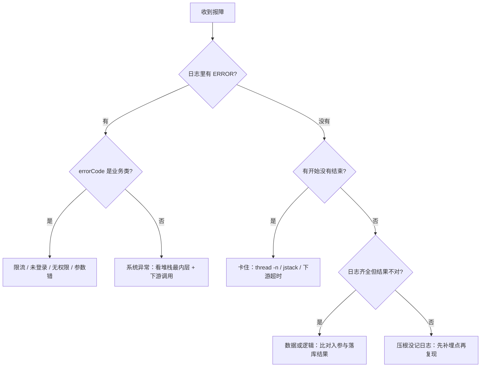

# Java 后端日志排查手册：从单机堆栈到分布式链路

> 基于真实项目 `yu-ai-code-mother`（AI 零代码应用生成平台）的代码事实编写
> 面向：会看单机异常堆栈、没有分布式链路排查经验的 Java 后端
> 生成日期：2026-10-20

---

## 目录

- [0. 这份文档怎么用](#0-这份文档怎么用)
- [1. 心智模型：一次「点生成」的十跳](#1-心智模型一次点生成的十跳)
- [2. 什么时候必须查日志](#2-什么时候必须查日志)
- [3. 工具链落地（文件级）](#3-工具链落地文件级)
- [4. 排查方法论](#4-排查方法论)
- [5. 实战演练 A–G](#5-实战演练-ag)

---

## 0. 这份文档怎么用

三种读法，按你的时间选：

| 你有多少时间 | 读哪几节 | 目标 |
|---|---|---|
| 30 分钟 | 1 + 2 + 4.3 | 建立「链路是什么」和「没 traceId 怎么查」的直觉 |
| 半天 | 1 + 2 + 3 + 5A/5B/5C | 能动手改出第一条 traceId，并能排查最常见的三类问题 |
| 两周 | 全读 + 按第 3 节逐个落地 | 完成可观测性改造，能在面试里讲成故事 |

**先记住一句话**：你不是「不会查日志」，你的系统是「日志天生串不起来」——有指标、没链路；有日志点，但没有一个 ID 能把一次请求从入口串到下游。

---

## 1. 心智模型：一次「点生成」的十跳

### 1.1 十跳全景

| 链路上这一层 | 现在真会留下什么 | 缺什么 | 缺了会被误判成 |
|---|---|---|---|
| 浏览器 → `POST /api/chat/gen/code`（8125） | 后端这边 0 条 | 请求进入时刻、clientIp、traceId 的诞生点 | 用户说「点了没反应」，你无法判断请求到底有没有到后端 |
| 鉴权 + 限流：`AuthInterceptor.java:50/:54`、`RateLimitAspect.java:50` | 两处都只 `throw`，**一行日志都没有** | 失败类型、uri、sessionId、限流 key 与当前计数 | 401 和被限流在日志里等于「什么都没发生」 |
| `AppController.chatToGenCode` | **整个类 0 条 log** | appId、userId、message 长度、开始时间 | 定位不到是哪个应用的哪一次生成 |
| `AppServiceImpl.chatToGenCode`（83–117 行）+ `MonitorContextHolder`（`:103` set / `:115` clear） | **整段 0 条日志**；userId/appId 只在内存里，不进日志也不进线程 | 每一步的进出参、耗时；traceId 进 MDC 和 pattern | 「卡住」时分不清卡在查库、卡在模型、还是卡在落盘 |
| LangChain4j 调 DeepSeek | 靠框架开关：local 是 `log-requests/log-responses: true`（把完整 prompt 和响应打进日志），`application-prod-sample.yml` 是 `false` | 模型名、第几次重试、prompt 长度或 hash、耗时、token 数 | 开发环境被几万字 prompt 淹掉；生产环境一条都没有 |
| 流式回调 → `StreamHandlerExecutor` → `JsonMessageStreamHandler` | 全链路只有 1 条：`JsonMessageStreamHandler.java:111 log.error("不支持的消息类型: {}", typeEnum)` | chunk 计数、累计长度、结束 / 取消信号 | 「流发到一半停了」分不清是模型断、后端断还是前端断 |
| 落盘：`CodeParser` / `CodeFileSaver` / `CodeFileSaverTemplate` | 三个类 **0 条**；只有 `AiCodeGeneratorFacade.java:162` 一行「保存成功，目录为：…」 | appId、文件数、总字节、耗时 | 「生成成功但文件不全 / 路径错」无迹可查 |
| 构建：`VueProjectBuilder.executeCommand`（120–146 行） | 4 条：`:122` 执行命令、`:131` 超时强制终止、`:140` 退出码、`:144` 异常；**从不读子进程的 stdout/stderr** | 子进程完整输出、退出码、耗时、工作目录 | npm 的真实报错永久丢失；管道写满还会把子进程憋死，最后伪装成「超时」 |
| 截图：`InnerScreenshotService`（tri，timeout 120000）→ `ScreenshotServiceImpl:30/:38`、`WebScreenshotUtils:116/:177` | 两边各有几条日志，但**没有任何一个共同字段** | 两端 traceId、Dubbo 侧耗时、Chrome 启动耗时、页面加载耗时 | 并发一上来，只能靠「时间差不多」猜是哪一次调用，一猜就错 |
| 出口：`GlobalExceptionHandler` | 只有 `log.error("BusinessException", e)` / `("RuntimeException", e)` 加堆栈；SSE 请求走 `handleSseError` 写 `event: business-error` + `event: done` | uri、userId、errorCode、入参、traceId | 所有业务异常长得一模一样，分不清限流 / 未登录 / 无权限 / 参数错 |

### 1.2 四个词，先弄清

**traceId**：一次请求的订单号。用户点一下生成，从头到尾只该有一个。
> 类比：你去餐厅点单拿到的号牌，不管菜经过凉菜间、热菜间还是打包台，都还是这个号。

**spanId**：这一次请求里某一个「动作」的编号。
> 类比：同一张订单，凉菜间那张小票、热菜间那张小票各有自己的编号，但都能追回同一个订单号。一次请求 = 1 个 traceId + N 个 spanId 组成的一棵树。

**traceparent**：把 traceId 写进 HTTP 请求头时用的标准格式（W3C 定的）：

```text
00-8f3c1a2b9d4e5f60-8f3c1a2b9d4e5f61-01
│  │                │                └ 采样标记
│  │                └ 父 spanId
│  └ traceId（32 位十六进制）
└ 版本
```

> 类比：跨厨房传递的那张「传菜小票」的固定版式——订单一号、上一站编号、要不要记录。

**MDC**：日志框架给每个线程挂的一块「随身白板」，你往上面写 `traceId=xxx`，这个线程之后打的每条日志都能自动带上。
> 类比：员工胸前的工牌。

**关键就在这**：胸牌挂在**人**身上，不挂在**订单**上。你换个线程（Tomcat 线程池借一个新线程、Reactor 回调线程、CompletableFuture 线程池、LangChain4j 的 OkHttp 回调线程、Dubbo 的 tri 线程），等于换了个员工，工牌就没了。

### 1.3 你写的 `MonitorContextHolder` 就是 MDC 的雏形

`monitor/MonitorContextHolder.java` 是普通 `ThreadLocal<MonitorContext>`，注释自己写了「监控上下文持有者（同线程内共享）」。它和 MDC 死在同样两件事上：

**1. 跨线程**

`AppServiceImpl:103` 在 Tomcat 线程上 `set`，等到 LangChain4j 在 OkHttp 线程回调、`ImageCollectorNode` 在 ForkJoin 线程抓图时，`getContext()` 已经是 `null`。

证据就在你自己的代码里：

- `AiModelMonitorListener.onResponse` 学乖了，改用 `attributes` 传上下文；
- `onError`（第 65 行）还傻乎乎直接 `getContext().getUserId()` —— **回调线程上必 NPE**。

**2. 跨服务**

ThreadLocal 不走网线。app 调 `InnerScreenshotService` 时，tri 协议不会自动把你线程上的东西带过去，必须显式塞进 attachment。

### 1.4 今天一次「成功」的生成，日志里到底长什么样

（线程名按 Spring 默认格式写的，属于推测；抓一次就准了）

```text
2026-10-20 20:50:29.412  INFO 8125 --- [nio-8125-exec-3] c.y.y.ai.AiCodeGeneratorServiceFactory : 为 appId: 1900000000000001 创建新的 AI 服务实例
2026-10-20 20:50:31.008  INFO 8125 --- [OkHttp-1] d.l.m.o.OpenAiStreamingChatModel : Request:
...（这里是一整段系统提示词 + 用户提示词，几千字）
2026-10-20 20:51:47.330  INFO 8125 --- [nio-8125-exec-3] c.y.y.core.AiCodeGeneratorFacade : 保存成功，目录为：D:\code_output\html_1900000000000001
2026-10-20 20:51:52.115 ERROR 8125 --- [nio-8125-exec-3] c.y.y.core.builder.VueProjectBuilder : 命令执行失败，退出码: 1
```

五行。看上去还挺全，但：

- **哪一行能证明「这是同一次请求」**？没有。只能靠时间戳猜。
- appId 在哪？在第 1 行和第 3 行的**字符串里**——它不是字段，搜 `appId=1900000000000001` 搜不到，只能全文匹配那串数字。
- 20:50:47 时用户还卡着，能说清是模型没回、还是落盘卡住吗？不能，因为中间 76 秒**一行日志都没有**。

### 1.5 改造之后应该长这样

注意：**traceId 不变，spanId 和线程名在变**——这才叫「一条链」。

```text
2026-10-20 20:50:29.412  INFO [yu-ai-code-app,8f3c1a2b9d4e5f60,8f3c1a2b9d4e5f61] [nio-8125-exec-3] c.y.y.c.AppController : gen.start appId=1900000000000001 userId=7 msgLen=214
2026-10-20 20:50:29.590  INFO [yu-ai-code-app,8f3c1a2b9d4e5f60,8f3c1a2b9d4e5f62] [nio-8125-exec-3] c.y.y.s.i.AppServiceImpl : gen.validated appId=1900000000000001 type=HTML costMs=178
2026-10-20 20:50:31.008  INFO [yu-ai-code-app,8f3c1a2b9d4e5f60,8f3c1a2b9d4e5f63] [OkHttp-1] c.y.y.ai.LlmCall : llm.request model=deepseek-chat attempt=1 promptHash=3f9a16b2 len=5218
2026-10-20 20:51:47.330  INFO [yu-ai-code-app,8f3c1a2b9d4e5f60,8f3c1a2b9d4e5f64] [OkHttp-1] c.y.y.ai.LlmCall : llm.response status=200 chunks=1840 costMs=76322
2026-10-20 20:51:47.402  INFO [yu-ai-code-app,8f3c1a2b9d4e5f60,8f3c1a2b9d4e5f65] [nio-8125-exec-3] c.y.y.core.AiCodeGeneratorFacade : save.done appId=1900000000000001 files=3 bytes=18422 costMs=72
2026-10-20 20:51:52.115 ERROR [yu-ai-code-app,8f3c1a2b9d4e5f60,8f3c1a2b9d4e5f66] [proc-npm-1] c.y.y.core.builder.VueProjectBuilder : npm.build.fail appId=1900000000000001 exit=1 costMs=4713 stdout=SHA256 not found...
```

差别只有两件事：**每条日志带上了同一个 traceId**，**每个关键节点都有「开始」和「结束 + 耗时」**。这两件做到，才可能「走链路」。

### 1.6 小结

你的系统现在不是「日志不够多」，是**每个节点各自说话，且没报姓名**。74 个日志点里，真正落在生成主链路上的只有 3 条，而且都不带请求标识。

---

## 2. 什么时候必须查日志

### 2.1 五个硬信号

满足任意一条，就不要再靠猜，直接开日志：

1. **指标动了，但接口「看起来」正常**。Grafana 上 `ai_model_errors_total` 缓慢上涨，用户说「还行」。指标只能告诉你「有错」，说不出「谁、为什么」。
2. **用户说「偶发」「有时候」**。不可复现 = 没有现场 = 日志是唯一的历史记录。
3. **同一个接口，只有一部分用户失败**。这就从「代码是不是错」变成了「数据 / 权限 / 配额」，必须在 userId / appId 维度上切。
4. **跨进程调用耗时超过 P99**。tri 那个 120000 摆在那儿，就必须能分出是「慢」还是「卡死」——只有成对的「开始 / 结束」日志能证明。
5. **本地跑一次好好的**。差异只可能来自环境、数据、并发，三样都只存在于线上。

### 2.2 反过来的信号（这些不用开日志）

编译不过、本地必现的逻辑错误、单测能覆盖的边界——**直接 debug 更快**。日志是给「回不去现场」的问题用的。

### 2.3 七个现象，各自该往哪看

| 现象（用户/客服原话） | 先看哪层 | 抓哪些字段 | 常见根因 | 下一步 |
|---|---|---|---|---|
| 「一直在转圈，就是不结束」 | app 的 `AppController` → `AiCodeGeneratorFacade` 有没有「开始」；再看 LangChain4j 有没有 request 没 response；最后看 tri 的 120000 | appId、开始时间、最后一条 chunk 的时间、线程名、screenshot/user 侧有没有对应调用 | ① 模型侧 hang 且无独立超时 ② 网关/代理缓冲，chunk 到不了浏览器 ③ 后端已结束但前端没收到 done | 没 response：先看 `log-requests` 开关，再 `jstack` 抓线程栈；chunk 正常产出：查网关 buffering |
| 「生成成功、页面也显示了，但部署出来打不开」 | `VueProjectBuilder.executeCommand` 的退出码；再看 `deployApp` 落的 URL 和 COS 上传 | exitCode、workingDir、command、appId、deployHost | ① npm install/build 真失败（依赖、Node 版本）② 超时被 `destroyForcibly` ③ 部署目录或 COS 路径错 | 先到服务器上手动跑同一命令；区分 exitCode 是 1 还是自定义超时分支 |
| 「点生成没反应」（其实是限流 / 未登录 / 无权限三者之一） | `GlobalExceptionHandler` 那一行 + `AuthInterceptor` / `RateLimitAspect` | uri、errorCode、userId、sessionId、限流 key | 限流命中 / Session 过期（Redis 里没了）/ app.userId 不匹配 | 改日志前：先看浏览器里响应体的 `code`；改日志后：一眼分清 |
| 「截图一直不出来 / 报超时」 | app 侧调用点耗时 + screenshot 进程日志 + `WebScreenshotUtils` | traceId（两端要同一个）、innerService=screenshot、Dubbo 耗时、Chrome 启动耗时、chrome 进程数 | ① Chrome 首次启动慢 ② `pageLoadTimeout` 30s 超了 ③ 僵尸 Chrome 占内存 ④ Dubbo 线程池打满 | `jps` / 任务管理器看 chrome 进程数；Arthas `thread` 看 tri 线程池 |
| 「Grafana 上错误率涨了，但日志里一条都搜不到」 | 先看 `ai_model_errors_total` 的 tag，再回 app 日志按 app_id + 时间窗搜 | app_id、model_name、error_message 这个 tag、时间窗 | ① `onError` 里 ThreadLocal 是 null，NPE 把日志淹了 ② 错误只进了指标没进日志 ③ 日志没落到文件 | 先确认日志文件里该时间窗到底有没有 ERROR：分清「没记」还是「没到」 |
| 「构建失败，只知道退出码 1」 | `VueProjectBuilder` 的 `:140` + 服务器上手动跑同命令 | command、workingDir、exitCode、耗时 | 依赖缺失、网络、Node 版本、文件权限 | 手动跑一次拿到真报错；改造后让 patch 把 stdout 尾巴读出来 |
| 「AI 一直超时 / 报 429」 | LangChain4j 的 request/response 日志 + `max-retries: 3` | attempt、status、耗时、token、appId、model_name | 配额限流、并发过高、单次 prompt 太长 | 按 appId 聚合看是否集中在少数用户；对比 P99 与重试次数 |

### 2.4 说清「课程项目级」和「生产级」

| 级别 | 标志 | 现在的状态 |
|---|---|---|
| 能跑 | 有异常堆栈 | 已有（`GlobalExceptionHandler`） |
| **能查** | **一次请求能被还原** | **缺（无 traceId、主链路无日志）** |
| 能预警 | 指标 + 告警规则 | 一半（有指标，无告警） |

**第二行才是要补的**，也是面试里「你怎么排查线上问题」真正想听的那一层。

---

## 3. 工具链落地（文件级）

总原则：**先让一条线能串起来，再谈好看**。顺序不能反——先 traceId 进日志，再跨服务，再跨线程，最后才是格式和检索。反过来做（先搞 Grafana 面板）就永远串不起来。

### 3.1 logback-spring.xml

放哪里：`yu-ai-code-common/src/main/resources/`（app / user / screenshot 都依赖它，classpath 能找到）；单体 `src/main/resources/` 再放一份。

三个进程的 `spring.application.name` 分别是 `yu-ai-code-app` / `yu-ai-code-user` / `yu-ai-code-screenshot`，正好拿来当文件名。

```xml
<?xml version="1.0" encoding="UTF-8"?>
<configuration>
    <springProperty scope="context" name="APP" source="spring.application.name" defaultValue="unknown"/>
    <property name="LOG_HOME" value="${LOG_HOME:-./logs}"/>
    <property name="PATTERN"
              value="%d{yyyy-MM-dd HH:mm:ss.SSS} %-5level [${APP},%X{traceId:-},%X{spanId:-}] [%thread] %logger{36} - %msg%n"/>

    <appender name="CONSOLE" class="ch.qos.logback.core.ConsoleAppender">
        <encoder><pattern>${PATTERN}</pattern><charset>UTF-8</charset></encoder>
    </appender>

    <appender name="FILE" class="ch.qos.logback.core.rolling.RollingFileAppender">
        <file>${LOG_HOME}/${APP}.log</file>
        <rollingPolicy class="ch.qos.logback.core.rolling.SizeAndTimeBasedRollingPolicy">
            <fileNamePattern>${LOG_HOME}/${APP}.%d{yyyy-MM-dd}.%i.log.gz</fileNamePattern>
            <maxFileSize>200MB</maxFileSize>
            <maxHistory>7</maxHistory>
            <totalSizeCap>5GB</totalSizeCap>
        </rollingPolicy>
        <encoder><pattern>${PATTERN}</pattern><charset>UTF-8</charset></encoder>
    </appender>

    <appender name="ASYNC_FILE" class="ch.qos.logback.classic.AsyncAppender">
        <queueSize>8192</queueSize>
        <discardingThreshold>0</discardingThreshold>
        <appender-ref ref="FILE"/>
    </appender>

    <logger name="com.yupi.yuaicodemother" level="INFO"/>
    <logger name="org.apache.dubbo" level="WARN"/>
    <!-- 别把 LangChain4j 的原始请求体当常态日志：要看时临时调 DEBUG，看完调回来 -->
    <logger name="dev.langchain4j" level="INFO"/>

    <root level="INFO">
        <appender-ref ref="CONSOLE"/>
        <appender-ref ref="ASYNC_FILE"/>
    </root>
</configuration>
```

两个坑：

- **异步 appender 会丢日志吗**？`discardingThreshold=0` 表示队列满了连 INFO 也不丢，会阻塞写日志的线程。SSE 场景日志量大，先这样（宁可慢一点，别丢现场）。
- **`%X{traceId:-}` 在没值时打空**，所以会看到 `[yu-ai-code-app,,]`。这不是 bug，是「这一行没处在链路里」的显式信号——反而是好事。

### 3.2 入口 traceId

放 `yu-ai-code-common` 的 `config` 包（三个进程都自动生效）。

```java
@Component
@Order(Ordered.HIGHEST_PRECEDENCE)
public class TraceIdFilter extends OncePerRequestFilter {

    public static final String TRACE_ID = "traceId";
    public static final String SPAN_ID  = "spanId";
    public static final String HEADER    = "X-Trace-Id";

    private static final Pattern TRACEPARENT =
            Pattern.compile("^[0-9a-f]{2}-([0-9a-f]{32})-([0-9a-f]{16})-[0-9a-f]{2}$");

    @Override
    protected void doFilterInternal(HttpServletRequest req, HttpServletResponse resp, FilterChain chain)
            throws ServletException, IOException {
        String traceId = resolveTraceId(req);
        MDC.put(TRACE_ID, traceId);
        MDC.put(SPAN_ID, hex(16));
        resp.setHeader(HEADER, traceId);        // 这一行是整个方案的地基
        try {
            chain.doFilter(req, resp);
        } finally {
            MDC.remove(TRACE_ID);
            MDC.remove(SPAN_ID);
        }
    }

    private String resolveTraceId(HttpServletRequest req) {
        String tp = req.getHeader("traceparent");
        if (tp != null) {
            Matcher m = TRACEPARENT.matcher(tp.trim().toLowerCase());
            if (m.matches()) return m.group(1);         // 有网关就复用上游的，别自己造
        }
        String fromClient = req.getHeader(HEADER);
        if (fromClient != null && fromClient.matches("[0-9a-f]{32}")) return fromClient;
        return hex(32);
    }

    private static String hex(int len) {
        byte[] b = new byte[len / 2];
        ThreadLocalRandom.current().nextBytes(b);
        StringBuilder sb = new StringBuilder(len);
        for (byte x : b) sb.append(String.format("%02x", x & 0xff));   // & 0xff 别忘了，否则负数会打成 ffffff
        return sb.toString();
    }
}
```

**为什么一定要回写响应头**：这是你唯一能把「用户嘴里的那次请求」和「日志里的那条链」对上的通道。前端把 `X-Trace-Id` 存进 localStorage，出错时弹「错误编号 8f3c1a2b…，请提供给客服」；客服一报，直接搜。

### 3.3 跨服务：Dubbo tri

app 是消费方（`InnerUserService`、`InnerScreenshotService`），user 和 screenshot 是提供方（`@DubboService`）。

```java
// 消费方
@Activate(group = CommonConstants.CONSUMER, order = -10000)
public class TraceConsumerFilter implements Filter {
    @Override
    public Result invoke(Invoker<?> invoker, Invocation inv) throws RpcException {
        String traceId = MDC.get("traceId");
        if (traceId != null) {
            RpcContext.getClientAttachment().setAttachment("traceid", traceId);   // 注意是小写
            RpcContext.getClientAttachment().setAttachment("spanid",  MDC.get("spanId"));
        }
        return invoker.invoke(inv);
    }
}
```

```java
// 提供方
@Activate(group = CommonConstants.PROVIDER, order = -10000)
public class TraceProviderFilter implements Filter {
    @Override
    public Result invoke(Invoker<?> invoker, Invocation inv) throws RpcException {
        String traceId = RpcContext.getServerAttachment().getAttachment("traceid");
        if (traceId == null) traceId = RpcContext.getServerContext().getAttachment("traceid");
        if (traceId == null) return invoker.invoke(inv);
        MDC.put("traceId", traceId);
        MDC.put("spanId", hex(16));          // 新一跳，spanId 必须新生成
        try {
            return invoker.invoke(inv);
        } finally {
            MDC.remove("traceId");
            MDC.remove("spanId");
        }
    }
}
```

生效方式（SPI 文件）：`META-INF/dubbo/org.apache.dubbo.rpc.Filter`

```text
traceConsumer=com.yupi.yuaicodemother.config.TraceConsumerFilter
traceProvider=com.yupi.yuaicodemother.config.TraceProviderFilter
```

再在 app 的 yml 里 `dubbo.consumer.filter=traceConsumer`；user / screenshot 里 `dubbo.provider.filter=traceProvider`。

**tri 协议专属的坑**（选 tri 会踩、选 dubbo 协议不会踩）：Triple 走 HTTP/2，attachment 会被编码成 HTTP header。所以键名必须**全小写、合法 header token**（不能有下划线、不能驼峰），值 Dubbo 会自动 URL 编码。写成 `traceId` 而不是 `traceid`，**不会报错**，只会在提供方**静默取到 null**。

### 3.4 跨线程：四类换人点，区别对待

| 换人点 | 在哪个类 | 能不能自动继承 | 怎么补 |
|---|---|---|---|
| Tomcat 线程池（请求之间复用） | `AppController` / `AppServiceImpl` | 能：Filter 里 set，finally 里 clear | 已经对了，别在线程池里留残留（`:115` 的 `doFinally` 就是干这个） |
| Reactor 回调（Flux 的 onNext） | `AiCodeGeneratorFacade:79` → 流式回调 | 半自动：要靠 Reactor Context 传播 | 首选 `Hooks.enableAutomaticContextPropagation()` + `context-propagation` 依赖；不想加依赖就手写 `MdcContextLifter` |
| 自建线程池 / CompletableFuture | `ImageCollectorNode`（`CompletableFuture.supplyAsync`） | 不能：`TaskDecorator` 只对 Spring 的 `ThreadPoolTaskExecutor` 生效 | 裸的 `supplyAsync` 用 commonPool，只能手工 copy |
| LangChain4j 的 OkHttp 回调 | `AiModelMonitorListener` 的三个回调 | 不能：第三方库自己的线程，插不进去 | 只能走「参数传递」：上下文塞进 `attributes`（`onResponse` 已这么干，`onError:65` 还没改） |
| Dubbo tri 线程池 | `InnerScreenshotServiceImpl` / `InnerUserServiceImpl` | 不能 | 就是上面 3.3 的 Provider Filter |

**首选方案**（Spring Boot 3.5 原生支持）：

```xml
<dependency>
    <groupId>io.micrometer</groupId>
    <artifactId>context-propagation</artifactId>
</dependency>
```

```java
@Configuration
public class ReactorContextConfig {
    static {
        Hooks.enableAutomaticContextPropagation();   // MDC 会随 operator 自动还原
    }
}
```

**裸线程池的通用补丁**：

```java
public final class MdcRunnable {
    public static Runnable wrap(Runnable r) {
        Map<String, String> ctx = MDC.getCopyOfContextMap();
        return () -> {
            if (ctx != null) MDC.setContextMap(ctx);
            try { r.run(); } finally { MDC.clear(); }
        };
    }
}
// ImageCollectorNode 里：CompletableFuture.supplyAsync(MdcRunnable.wrap(() -> ...))
```

### 3.5 指标和日志挂钩

已有：`ai_model_requests_total{user_id, app_id, model_name, status}`。差一步就闭环：

- 在 `AiModelMetricsCollector` 打点的地方，同时 `log.info("llm.metric appId={} model={} status={}", ...)` —— **同一次事件，指标和日志各记一份，字段名保持一致**。
- 排查顺序就固定了：Grafana 上 `status="error"` 涨 → 拿到 `app_id` 和时间窗 → 回日志搜 `appId=...` + `level=ERROR` → 拿到 traceId → 全链路铺开。

**一句话**：指标负责「出事了」，日志负责「为什么」，traceId 是两边的接头暗号。

### 3.6 Arthas 四条命令

```bash
# 1) 慢在哪一层：只看耗时超过 1000ms 的调用
trace com.yupi.yuaicodemother.service.impl.AppServiceImpl chatToGenCode '#cost > 1000'

# 2) 现场参数：npm 到底传了什么命令、返回什么
watch com.yupi.yuaicodemother.core.builder.VueProjectBuilder executeCommand \
  '{params[1], params[2], returnObj}' -x 2 -n 5

# 3) 谁调的我：onError 是从哪个线程/哪条链路上来的（查 NPE 归属）
stack com.yupi.yuaicodemother.monitor.AiModelMonitorListener onError

# 4) 卡住时看线程：最忙的 3 个 + 有没有死锁
thread -n 3
thread -b
thread --state TIMED_WAITING | grep -i dubbo
```

对应关系：**不知道慢在哪 → trace；不知道参数是什么 → watch；不知道谁触发的 → stack；整站卡住 → thread**。

### 3.7 检索语句

```text
# Kibana KQL
traceId: "8f3c1a2b9d4e5f60"
appId: 1900000000000001 and log.level: "ERROR"
message: "npm.build.fail" and not appId: *
```

```text
# Loki LogQL
{app="yu-ai-code-app"} |= "8f3c1a2b9d4e5f60"
{app=~"yu-ai-code-(app|screenshot)"} |= "innerService=screenshot"
sum by (app) (count_over_time({app=~"yu-ai-code-.*"} |= "ERROR" [5m]))
```

没有 Loki 时，`grep` 顶上：

```bash
grep -h "8f3c1a2b9d4e5f60" logs/yu-ai-code-app.log logs/yu-ai-code-screenshot.log
```

---

## 4. 排查方法论

### 4.1 8 步 SOP

| 步 | 输入 | 看什么 | 满足什么进下一步 | 什么情况退回 |
|---|---|---|---|---|
| 1 定性 | 用户原话 + 时间 | 是一个人还是一片人；接口整体挂还是偶发 | 能说清影响面 | 影响面说不清 → 先看 Grafana 大盘，别翻日志 |
| 2 定窗定键 | 报障时间 | appId、userId、traceId（响应头）、前后各 2 分钟 | 手上有一个可全文检索的键 | 一个键都没有 → 走 4.3 野路子 |
| 3 定层 | 入口日志 | 「开始」那行在不在：Controller / Service / Facade | 找到最后一个有日志的节点 | 入口都没日志 → 根本没到后端（前端/网络/网关） |
| 4 找断点 | 「开始/结束」配对 | 哪一对只有开始没有结束 | 锁定一个节点 | 配对全齐 → 不是卡住，是结果错，跳到第 6 步 |
| 5 交叉验证 | 指标 + 线程栈 | 该时间窗 `ai_model_*` 是否同向；`thread -n 3` | 指标和日志指向同一层 | 两边矛盾 → 先信指标（日志可能没落盘），去查日志管道 |
| 6 拿现场 | Arthas watch / 日志入参 | 真实参数、真实返回、真实异常 | 能复现或能解释 | 复现不了 → 只能靠历史日志，补埋点后再等一次 |
| 7 修 + 补 | 根因 | 修完顺手补这次缺的字段 | 下次同类问题 1 分钟能定位 | 只修不补 → 下次还得从头猜 |
| 8 复盘 | 整条链 | 把现象写进「现象→先看哪层」那张表 | 新人照着表也能查 | 跳过 → 经验只在你脑子里，面试也讲不出来 |

### 4.2 决策树



### 4.3 没有 traceId 时的野路子

**核心思路一句话**：没有唯一 ID，就用**时间**当主键，把四个时间锚点排成一条轴，看轴在哪断。

| 锚点 | 从哪拿 | 精度 |
|---|---|---|
| 用户点击时刻 | 客服/用户口述，或前端埋点 | ±1 分钟 |
| 消息落库时刻 | `chat_history.create_time`（用户消息那行） | 毫秒 |
| 模型请求时刻 | app 日志里 LangChain4j 的 request | 毫秒 |
| 文件落盘时刻 | 生成目录的 mtime，或 `AiCodeGeneratorFacade:162` 那行 | 毫秒 |
| RPC 调用时刻 | screenshot 日志里 `ScreenshotServiceImpl:30` 的「开始」 | 毫秒 |

**五步操作**：

1. **定窗**：报障时间 ±2 分钟。先确认时区一致（日志是 +08:00，服务器若是 UTC 会差 8 小时，这个坑吃一次记一辈子）。
2. **取键**：appId + userId（从页面 URL 或库里拿），别用「大概那个应用」。
3. **全文搜**：app 日志里搜 appId 那串数字。注意——appId 现在不是结构化字段，只能全文匹配，这就是缺字段的代价。
4. **排轴**：把命中的时间戳按顺序列出来，标出「有开始没结束」的那一段。
5. **跨进程对齐**：拿时间窗去 screenshot / user 日志里搜，看有没有落在同一秒附近的条目；有 → 调用到达了；没有 → 断在 RPC 之前（网络、注册中心、Dubbo 线程池）。

**一个真实推演**（用现在的代码，一次「卡住」）：

```text
20:50:29.412  app        为 appId: 1900000000000001 创建新的 AI 服务实例      ← 锚点：请求进来了
20:50:29.5xx  MySQL      chat_history 出现一条 USER 消息（create_time）      ← 锚点：写库成功
20:50:31.008  app        Request: ...（log-requests 开着才有）               ← 锚点：调模型了
20:51:47.330  app        保存成功，目录为：...html_1900000000000001           ← 锚点：流结束 + 落盘了
（之后什么都没有）
```

三个结论：① 请求确实到了后端；② 模型调用持续约 76 秒（不是卡死，是慢）；③ 落盘成功但之后再无日志——所以「卡住」不是卡在生成，是卡在**落盘之后**。落盘之后是 `deployApp` → `VueProjectBuilder` → 截图。去 `chat_history` 查有没有 AI 消息那行：有 → 卡在部署/构建；没有 → 卡在 `StreamHandlerExecutor` 的累积落库。**两个不同的根因，靠一次 EXISTS 查询就分开了。**

> 注意：这条推演的严格性有缺陷——「保存成功」只能证明落盘完成，不能证明 SSE 流完整发到浏览器；要坐实还需 chunk 计数和一条独立的 `sse.done` 日志。

---

## 5. 实战演练 A–G

每个场景 8 段：**现象 → 该看哪层 → 日志长什么样 → 推理（含弯路）→ 命令 → 根因与修复 → patch → 一句话复盘**。

### 5.1 场景 A · SSE 一直转圈，等半小时也不结束

**① 现象**
> 「点了生成，一直在转圈，等了二十分钟还是不结束。刷新一下页面就没了，但我的应用也没生成出来。」

**② 该看哪层**

先分成两条完全不同的分支：

- **分支一：后端的流没结束** —— 模型侧不吐数据，或中间某处阻塞。断点在 `AiCodeGeneratorFacade.generateAndSaveCodeStream` 到 SSE 出口之间。
- **分支二：后端结束了，但 chunk 到不了浏览器** —— 代理缓冲、空闲连接被掐、前端 EventSource 自动重连（重连后看起来「一直在转」，其实是新一轮）。

**③ 现在的日志会长什么样**（线程名是推测）

```text
20:50:29.412  INFO  [nio-8125-exec-3] c.y.y.ai.AiCodeGeneratorServiceFactory : 为 appId: 1900000000000001 创建新的 AI 服务实例
20:50:31.008  INFO  [OkHttp-1] d.l.m.o.OpenAiStreamingChatModel : Request: ...
20:51:47.330  INFO  [nio-8125-exec-3] c.y.y.core.AiCodeGeneratorFacade : 保存成功，目录为：D:\code_output\html_1900000000000001
（之后什么都没有）
```

三个致命空白：

- 没有一行说明「SSE 流开始了」——`AppController` 全文 0 条日志。
- 没有一行说明「SSE 流结束了」——`doFinally` 里只 clear 上下文，不记日志（`AppServiceImpl:113–116`）。
- 没有一条 `ERROR`。在日志里搜「错误」什么也搜不到，然后开始怀疑前端。

**④ 推理过程**（含一次弯路）

- 第一反应：模型慢。`log-responses: true` 开着，`Response:` 应该会打出来——但只有 `Request:` 后面直接是「保存成功」。**弯路在这**：以为「有 Request 没 Response = 模型没回」，实际上流式模式下本来就不会有这么一行。
- 纠正思路：别猜模型，看**结论性日志**有没有出现。「保存成功」出现了 → 流走完、文件落盘了 → 问题不在后端流，在**传输**或**前端渲染**。
- 如果「保存成功」也没出现 → 才是后端卡住，去 `thread -n 3` 看是不是卡在 socket read。

**⑤ 具体命令**

```bash
# 1. 这条链路到底走到哪一步（appId 现在不是字段，只能全文搜）
grep -n "1900000000000001" logs/yu-ai-code-app.log

# 2. 卡住的时候抓三次堆栈，间隔 10 秒，看同一个线程停在哪
jstack <pid> > s1.txt; sleep 10; jstack <pid> > s2.txt; sleep 10; jstack <pid> > s3.txt
diff s1.txt s2.txt | head -40          # 停着不动的那段就是卡点

# 3. Arthas 里：看哪个线程最忙
thread -n 3
```

浏览器侧同步做一件事：F12 → Network → 点开那条 `chat/gen/code` 请求 → 看 **EventStream** 面板里还有没有新事件；停在最后一条就说明流断了。

**⑥ 根因与修复**

1. **Flux 分支没有总时长上限**。`CodeGenWorkflow` 那条 SseEmitter 分支设了 `30*60*1000L`（`:169–170`），但 `AppController` 走 Flux 那条**一点上限都没有**。tri 的 `timeout: 120000` 管的是 RPC 调用，管不到这条 HTTP 流。
2. **没有心跳**。SSE 空闲 30–60 秒，中间任何一层（Nginx、负载均衡、公司代理）都可能单方面断开。断了之后浏览器 EventSource 默认自动重连，于是「一直转」。
3. **`GlobalExceptionHandler` 把错误写成了 200 的 SSE 事件**（`event: business-error`）。所以浏览器 Network 里这条请求永远 200。

**⑦ patch**

```java
// controller/AppController.java
@GetMapping(value = "/chat/gen/code", produces = MediaType.TEXT_EVENT_STREAM_VALUE)
public Flux<ServerSentEvent<String>> chatToGenCode(@RequestParam Long appId,
                                                   @RequestParam String message,
                                                   HttpServletResponse response) {
    response.setHeader("X-Accel-Buffering", "no");   // 让 Nginx 别缓冲
    long t0 = System.currentTimeMillis();
    log.info("sse.start appId={} msgLen={}", appId, message.length());

    return aiCodeGeneratorFacade.generateAndSaveCodeStream(appId, message)
            .map(chunk -> ServerSentEvent.builder(chunk).event("message").build())
            .mergeWith(heartbeat())                                   // 15s 一次心跳
            .timeout(Duration.ofMinutes(5))                           // 总时长上限
            .doOnComplete(() -> log.info("sse.done appId={} costMs={}", appId, System.currentTimeMillis() - t0))
            .doOnCancel(() -> log.warn("sse.cancel appId={} costMs={}", appId, System.currentTimeMillis() - t0))
            .doOnError(e -> log.error("sse.error appId={} costMs={}", appId, System.currentTimeMillis() - t0, e));
}

private Flux<ServerSentEvent<String>> heartbeat() {
    return Flux.interval(Duration.ofSeconds(15))
            .map(i -> ServerSentEvent.builder("ping").event("heartbeat").build());
}
```

**⑧ 一句话复盘**

**SSE 转圈，先看「后端有没有打完」，再看「浏览器有没有收到」，中间那层代理和心跳是最大盲区。**

---

### 5.2 场景 B · 生成成功、页面也显示了，但部署出来的应用打不开

**① 现象**
> 「预览里都正常，点部署也提示成功了，但是打开那个链接是白屏。」
> 或者：「生成完直接提示失败，只说构建失败。」

**② 该看哪层**

`VueProjectBuilder.executeCommand`（`:120–146`）→ `deployApp` 落库的 URL → `deployHost` 配置 → 静态资源映射。Vue 项目比 HTML 多了「npm install + npm run build + dist 产物」三跳，每一跳都可能静默失败。

**③ 现在的日志**

成功但仍然打不开：

```text
20:51:47.330  INFO  [nio-8125-exec-3] c.y.y.core.AiCodeGeneratorFacade : 保存成功，目录为：D:\code_output\vue_1900000000000001
20:51:47.401  INFO  [nio-8125-exec-3] c.y.y.core.builder.VueProjectBuilder : 在目录 D:\code_output\vue_1900000000000001 中执行命令: npm.cmd install
20:52:39.008  INFO  [nio-8125-exec-3] c.y.y.core.builder.VueProjectBuilder : 命令执行成功: npm.cmd install
20:52:39.115  INFO  [nio-8125-exec-3] c.y.y.core.builder.VueProjectBuilder : 在目录 D:\code_output\vue_1900000000000001 中执行命令: npm.cmd run build
20:52:41.500  INFO  [nio-8125-exec-3] c.y.y.core.builder.VueProjectBuilder : 命令执行成功: npm.cmd run build
```

**四个 INFO，零个 ERROR，然后白屏。** `:140` 那句 `命令执行失败，退出码: {}` 只有 exitCode ≠ 0 才会打；而 exitCode = 0 不代表产物对。

失败但看不出原因：

```text
20:52:41.500 ERROR [nio-8125-exec-3] c.y.y.core.builder.VueProjectBuilder : 命令执行失败，退出码: 1
（就这一行。npm 到底报了什么，永久丢失）
```

**④ 推理过程**（含一次弯路）

- 第一反应：Node 环境问题。去服务器手动 `npm run build`，30 秒就成功——**这是弯路**，因为手动跑用的是 shell 环境，而 `ProcessBuilder` 继承的是 JVM 进程环境，PATH 可能不一样。
- 第二个怀疑：命令被拆错。`:123` 是 `RuntimeUtil.exec(null, workingDir, command.split("\\s+"))` —— **硬伤**：`split("\\s+")` 会把路径按空格切开。只要生成目录或项目路径带空格（Windows 用户目录很常见），命令立刻变成几个错误参数，npm 报「不认识这个参数」，exitCode 1，而报错文本没被读，只看到「退出码: 1」。
- 第三个怀疑（白屏但不报错那条）：exitCode 0 但 `dist` 目录不存在。`buildCommand` 若和实际脚手架不匹配，构建「成功」而产物为空。代码里**构建完从不校验 `dist/index.html` 存在**，所以静默成功。
- 隐藏杀手：**不排空管道**。Process 的 stdout/stderr 一直没人读，输出超过管道缓冲区（Linux 64KB），子进程写日志就会阻塞、永远不退出 → `waitFor` 超时 → `destroyForcibly` → 日志表现成「命令执行超时」，**而真因是被自己的输出憋死**。

**⑤ 具体命令**

```bash
# 1. 产物到底有没有
ls -l D:/code_output/vue_1900000000000001/dist/index.html

# 2. 日志里所有构建相关行
grep -nE "执行命令|退出码|执行超时|保存成功" logs/yu-ai-code-app.log | tail -30

# 3. 手动复现（同一条命令，同目录，Windows 要 .cmd）
cd D:/code_output/vue_1900000000000001 && npm.cmd run build; echo "exit=$?"

# 4. 看子进程是否僵着
jps -l; ps -ef | grep -i node
```

**⑥ 根因与修复**

1. `split("\\s+")` 拆命令 → 路径含空格必炸。**改用 `List<String>` 传参**。
2. 不读 stdout/stderr → 真报错丢失 + 管道写满憋死子进程。**必须起 drain 线程**。
3. 只看 exitCode，不校验产物 → 白屏但「成功」。**构建完检查 `dist/index.html`**。
4. 超时后 `destroyForcibly` 但不管子进程树 → npm 会 fork 子进程，杀父不杀子，残留 node 进程越来越多。**超时要杀进程树**。

**⑦ patch**

```java
// core/builder/VueProjectBuilder.java —— 替换 executeCommand 实现
private boolean executeCommand(File workingDir, List<String> command, int timeoutSeconds) {
    long t0 = System.currentTimeMillis();
    log.info("npm.start dir={} cmd={}", workingDir, String.join(" ", command));
    ProcessBuilder pb = new ProcessBuilder(command)
            .directory(workingDir)
            .redirectErrorStream(true);          // stderr 合进 stdout，一行代码解决一半问题
    try {
        Process p = pb.start();
        StringBuilder out = new StringBuilder();   // 只留尾巴，别把整份日志吃进内存
        Thread drain = new Thread(() -> {
            try (BufferedReader r = new BufferedReader(
                    new InputStreamReader(p.getInputStream(), StandardCharsets.UTF_8))) {
                String line;
                while ((line = r.readLine()) != null) {
                    synchronized (out) {
                        out.append(line).append('\n');
                        if (out.length() > 8_000) out.delete(0, out.length() - 8_000);
                    }
                }
            } catch (IOException ignored) { }
        }, "npm-drain");
        drain.setDaemon(true);
        drain.start();

        boolean finished = p.waitFor(timeoutSeconds, TimeUnit.SECONDS);
        drain.join(2_000);
        long cost = System.currentTimeMillis() - t0;

        if (!finished) {
            p.descendants().forEach(ProcessHandle::destroyForcibly);   // 连子进程一起杀
            p.destroyForcibly();
            log.error("npm.timeout dir={} costMs={} timeoutSec={} tail={}",
                    workingDir, cost, timeoutSeconds, tail(out));
            return false;
        }
        int exit = p.exitValue();
        if (exit != 0) {
            log.error("npm.fail dir={} exit={} costMs={} tail={}", workingDir, exit, cost, tail(out));
            return false;
        }
        log.info("npm.ok dir={} costMs={} tail={}", workingDir, cost, tail(out));
        return true;
    } catch (Exception e) {
        log.error("npm.error dir={} costMs={}", workingDir, System.currentTimeMillis() - t0, e);
        return false;
    }
}

private static String tail(StringBuilder sb) {
    synchronized (sb) { return sb.toString(); }
}
```

再补一道产物校验（Vue 分支专用）：

```java
Path index = workingDir.toPath().resolve("dist").resolve("index.html");
if (!Files.exists(index)) {
    log.error("build.nodist dir={}（构建进程 exit=0，但 dist/index.html 不存在）", workingDir);
    return false;
}
```

**⑧ 一句话复盘**

**外部进程的日志只有三样有用：命令、退出码、输出尾巴。缺任何一样，你都得手动重跑一遍。**

---

### 5.3 场景 C · 用户点「生成」没反应：其实是限流 / 未登录 / 无权限

**① 现象**
> 「点了生成按钮，页面一点反应都没有，也不报错。」
> 或者：「一直提示没权限，我是登录着的啊。」

**② 该看哪层**

三个地方会拦你：

- `AuthInterceptor`（`:50`、`:54`）→ Session 里没用户 → 未登录
- `AppServiceImpl:91`（userId 与 app 的 userId 不一致）→ 无权限
- `RateLimitAspect`（`:50`）→ `RRateLimiter.tryAcquire` 返回 false → 限流

三个都抛 `BusinessException`，三个都**不打日志**，最后统一落到 `GlobalExceptionHandler`。

**③ 现在的日志**

最常见的版本——**一行都没有**（`AuthInterceptor` 和 `RateLimitAspect` 都不打日志），偶尔有：

```text
20:53:10.201 ERROR [nio-8125-exec-5] c.y.y.e.GlobalExceptionHandler : BusinessException
com.yupi.yuaicodemother.exception.BusinessException: 无权限访问该应用
    at com.yupi.yuaicodemother.service.impl.AppServiceImpl.chatToGenCode(AppServiceImpl.java:92)
    at java.base/jdk.internal.reflect.DirectMethodHandleAccessor.invoke(DirectMethodHandleAccessor.java:103)
    ...
```

限流那条：

```text
20:54:02.880 ERROR [nio-8125-exec-7] c.y.y.e.GlobalExceptionHandler : BusinessException
com.yupi.yuaicodemother.exception.BusinessException: 操作过于频繁，请稍后再试
    at com.yupi.yuaicodemother.ratelimter.aspect.RateLimitAspect.limit(RateLimitAspect.java:51)
    ...
```

**这两行里没有 uri、没有 userId、没有 appId、没有 errorCode。** 只能靠「堆栈最内层是哪个类」反推是谁拦的。

**④ 推理过程**（含一次弯路）

- 第一反应：前端没发请求。让他 F12 看 Network——**发现请求是 200**。弯路在这：200 让你以为后端处理正常。
- 关键一步：看那条请求的 **EventStream 面板**，里面有 `event: business-error` 和 `data: {"code":40101,"message":"无权限访问该应用"}`。**这就是「点了没反应」的原因**——`handleSseError` 把业务异常写成了 SSE 事件（HTTP 200），前端没监听 `business-error` 时，界面上什么都不会发生。
- 所以「没反应」不是没抛异常，是**异常被包成了前端不认识的事件**。

**⑤ 具体命令**

```bash
# 1. 所有业务异常，看每条堆栈第一行是哪个类 —— 唯一的区分手段
grep -n -A 3 "GlobalExceptionHandler : BusinessException" logs/yu-ai-code-app.log \
  | grep "at com.yupi" | sort | uniq -c | sort -rn

# 2. 限流 key 在不在（Redisson RRateLimiter 的 key 在 Redis 里）
redis-cli --scan --pattern "*rate*"
redis-cli ttl <key>

# 3. Session 在不在（Spring Session 存 Redis）
redis-cli --scan --pattern "spring:session:*" | head
```

`RateLimitAspect` → 限流；`AuthInterceptor` → 未登录；`AppServiceImpl` → 无权限。

**⑥ 根因与修复**

1. **三类失败共用一个出口，且出口不记字段** → 排查靠堆栈反推，慢且易错。
2. **业务异常被包成 200 + SSE 事件** → 前端没处理 `business-error`，用户看到「没反应」。
3. **限流、鉴权处完全无日志** → 连「有没有触发」都不知道。

**⑦ patch**

```java
// exception/GlobalExceptionHandler.java
@ExceptionHandler(BusinessException.class)
public BaseResponse<?> businessExceptionHandler(BusinessException e, HttpServletRequest request) {
    log.error("biz.fail code={} msg={} uri={} userId={} appId={}",
            e.getCode(), e.getMessage(), request.getRequestURI(),
            currentUserId(), request.getParameter("appId"), e);   // e 必须放最后一个参数
    return ResultUtils.error(e.getCode(), e.getMessage());
}
```

注意 `e` 的位置——`log.error("BusinessException", e)`（现在的写法）会**丢掉 message**，只留堆栈；`log.error("msg={}", x, e)` 才是「占位符 + 异常」的正确姿势。项目里 `WebScreenshotUtils:85` 写对了，`GlobalExceptionHandler` 写错了，可以对照看。

```java
// aop/AuthInterceptor.java —— 两处 throw 之前
log.warn("auth.reject uri={} sessionId={} reason={}",
        request.getRequestURI(), session.getId(), "no-login");
```

```java
// ratelimter/aspect/RateLimitAspect.java —— tryAcquire 返回 false 的分支
log.warn("ratelimit.reject key={} type={} userId={} uri={} limit={}",
        key, rateLimit.type(), currentUserId(), request.getRequestURI(), rateLimit.rate());
```

前端也补一句：`EventSource` / `fetch` 流里监听 `business-error`，把 `data.message` 弹出来，把 `X-Trace-Id` 存起来。

**⑧ 一句话复盘**

**所有 4xx 业务异常，日志里必须有 code + uri + userId。有这三样，限流和未登录永远不会混。**

---

### 5.4 场景 D · 截图偶发超时 / app 侧报 Dubbo timeout

**① 现象**
> 「有时候生成完没有截图，重试一次就有了」「日志里偶尔蹦一条 Dubbo 超时」。

**② 该看哪层**

不是一层，是**两个进程的时间差**：app 侧 `InnerScreenshotService`（consumer timeout 120000）→ screenshot 进程 `ScreenshotServiceImpl:30` → `WebScreenshotUtils`（Chrome 启动、`pageLoadTimeout` 30s、`implicitlyWait` 10s、`Thread.sleep(2000)`、WebDriverWait 10s）→ COS 上传。

**③ 日志（两边并排看）**

```text
# app 侧
20:52:41.600  INFO  [nio-8125-exec-3] c.y.y.s.i.AppServiceImpl : （调用截图，此处目前 0 条日志）
20:54:41.7xx  ERROR [nio-8125-exec-3] o.a.d.r.c.DubboInvoker : Waiting for response timeout 120000 ms, channel is not closed

# screenshot 侧
20:52:49.100  INFO  [DubboServerHandler-50052-thread-1] c.y.y.s.i.ScreenshotServiceImpl : 开始生成网页截图，URL：http://localhost:8123/api/static/html_1900000000000001/
20:54:50.200  INFO  [DubboServerHandler-50052-thread-1] c.y.y.s.i.ScreenshotServiceImpl : 截图上传成功，URL：https://cos...
```

**三个数字就是答案**：发起 20:52:41.6 → 服务端**才开始** 20:52:49.1（排队 7.5 秒）→ 服务端**干完** 20:54:50.2（耗时 121.1 秒）。而 timeout 是 120 秒。

**④ 推理（含一次弯路）**

- 第一反应：Dubbo 连接数不够 / tri 连接断了。**弯路**——tri 是 HTTP/2 多路复用，连接不是瓶颈。
- 纠正：算时间差。服务端总耗时 **121 秒 > 120 秒**，说明不是「偶发慢」，而是**长期贴着上限跑**。而且客户端超时后服务端不会停——继续跑完、继续占线程、继续写日志。这就是「偶发」的来源。
- 再往下：121 秒怎么来的？`pageLoadTimeout 30s` + `implicitlyWait 10s` + `Thread.sleep(2000)` + `WebDriverWait 10s` 是**串行叠加**的，加 Chrome 冷启动 3–8 秒、COS 上传几秒，正常路径就 40 秒上下；一旦页面某资源加载慢，30s 超时触发异常分支，再等一轮，就冲到 120 秒。
- 另一个放大器：`new ChromeDriver()` 之后不 `quit()`，每次泄漏一个 chrome 进程，几十次后内存吃紧，冷启动越来越慢——**「前几天好好的，今天开始偶发」的典型形状**。

**⑤ 命令**

```bash
# 两端时间差（最有用的一条）
grep -n "开始生成网页截图" logs/yu-ai-code-screenshot.log | tail -5
grep -n "截图上传成功" logs/yu-ai-code-screenshot.log | tail -5

# 僵尸 chrome 有几个
ps -ef | grep -c "[c]hrome"

# 服务端此刻卡在哪（Arthas）
thread --state TIMED_WAITING | grep -i "50052"
trace com.yupi.yuaicodemother.service.impl.ScreenshotServiceImpl generateAndUploadScreenshot '#cost > 30000'
```

**⑥ 根因**

1. timeout(120s) 与真实耗时(≈121s) 无裕量；
2. ChromeDriver 不 quit，进程泄漏；
3. 加载策略是「等所有资源」，`EAGER` 能省一半；
4. 客户端超时不中止服务端，浪费 + 雪崩；
5. 两端日志无共同字段，只能靠时间猜。

**⑦ patch**

```java
// utils/WebScreenshotUtils.java
ChromeOptions opts = new ChromeOptions();
opts.addArguments("--headless=new", "--no-sandbox", "--disable-dev-shm-usage",
        "--disable-gpu", "--hide-scrollbars");
opts.setPageLoadStrategy(PageLoadStrategy.EAGER);          // 不等图片/异步资源

WebDriver driver = null;
long t0 = System.currentTimeMillis();
try {
    driver = new ChromeDriver(opts);
    log.info("chrome.start ok costMs={}", System.currentTimeMillis() - t0);
    driver.manage().timeouts().pageLoadTimeout(Duration.ofSeconds(15));
    driver.manage().timeouts().implicitlyWait(Duration.ofSeconds(3));
    driver.get(webUrl);
    // ...
} finally {
    if (driver != null) {
        try { driver.quit(); log.info("chrome.quit ok totalMs={}", System.currentTimeMillis() - t0); }
        catch (Exception e) { log.error("chrome.quit fail", e); }
    }
}
```

```java
// service/impl/ScreenshotServiceImpl.java
long t0 = System.currentTimeMillis();
log.info("shot.start url={} method={}", url, method);
byte[] bytes = ...;
log.info("shot.done url={} size={} costMs={}", url, bytes.length, System.currentTimeMillis() - t0);
```

**⑧ 一句话复盘**

**Dubbo 超时先算两端时间差——客户端超时不等于服务端失败，服务端那条「完成」才是真相。**

---

### 5.5 场景 E · Grafana 错误率涨了，日志里一条都搜不到

**① 现象**

`ai_model_errors_total` 从 0 涨到 27/min，但 `grep ERROR logs/` 一条都没有。

**② 该看哪层**

不要先怀疑日志，先去找**谁在打这个指标**。入口在 `AiModelMetricsCollector`，上游是 `AiModelMonitorListener` 的 `onError`（`:65`）。

**③ 日志**

```text
# 指标侧（Prometheus 拉到的）
ai_model_errors_total{app_id="1900000000000001",model_name="deepseek-chat",status="error"} 27

# 日志侧
$ grep -c "ERROR" logs/yu-ai-code-app.log
0
```

**④ 推理（三步排除，第三步才是真因）**

- 第一步：级别不够？root 是 INFO，ERROR 必打 → 排除。
- 第二步：**日志压根没落盘**。现在没有 `logback-spring.xml`，Spring Boot 默认只往 console 打。如果进程是 `nohup java -jar ... > /dev/null 2>&1` 或 IDEA 里跑，文件里当然什么都没有。**「日志搜不到」有一半情况是「日志没写到你能搜的地方」**。
- 第三步：打点入口不是你以为的那个。`onError` 里第一句是 `MonitorContextHolder.getContext().getUserId()`（`:65`），回调线程上为 null → NPE。如果 NPE 在 `recordError` **之前**，指标不该涨；既然涨了，说明 **error 这条记录不是走 `onError` 进去的**——可能是 `onResponse` 里判定 status，或流式链路的 `onErrorResume` 里直接 record。正确动作：`grep -rn "recordError" src/main/java`，看它被谁调用。

**⑤ 命令**

```bash
grep -rn "recordError\|ai_model_errors" src/main/java | head
curl -s localhost:8125/api/actuator/prometheus | grep ai_model_errors
ls -l logs/ 2>/dev/null || echo "根本没有 logs 目录 —— 日志没落盘"
```

**⑥ 根因**

1. 指标和日志不是同一个出口（各写各的）；
2. 埋点用 ThreadLocal 在异步线程取值，值没了；
3. 埋点自己会抛异常，把后面的日志一起带走；
4. 没配 logback，日志只在 console。

**⑦ patch**

```java
// monitor/AiModelMonitorListener.java —— onError 重写
@Override
public void onError(ChatModelErrorContext ctx) {
    try {
        MonitorContext mc = (MonitorContext) ctx.attributes().get(MONITOR_CONTEXT_KEY);  // 别用 ThreadLocal
        Long userId = mc == null ? null : mc.getUserId();
        Long appId  = mc == null ? null : mc.getAppId();
        Throwable err = ctx.error();
        log.error("llm.error appId={} userId={} errType={} msg={}",
                appId, userId, err.getClass().getSimpleName(), err.getMessage(), err);
        metricsCollector.recordError(userId, appId, modelName(ctx), err.getMessage());
    } catch (Exception e) {
        log.error("monitor.onError fail", e);   // 监控埋点绝不允许影响主流程
    }
}
```

**⑧ 一句话复盘**

**指标涨了日志没有，先去找「谁在打这个指标」，而不是先怀疑日志——它们往往不是同一个出口。**

---

### 5.6 场景 F · DeepSeek 429 / 超时，max-retries 把 P99 拉爆

**① 现象**
> 「AI 老超时，用户狂点重试」「日志里偶尔 429」。

**② 该看哪层**

`max-retries: 3` + `log-requests/log-responses`（prod 是 false）+ 路由模型 qwen-turbo 兜底。

**③ 日志**

```text
20:55:01.100  INFO  [OkHttp-1] d.l.m.o.OpenAiStreamingChatModel : Request: ...
20:55:31.400  WARN  [OkHttp-1] d.l.m.o.OpenAiStreamingChatModel : Retrying request... attempt 2
20:56:02.900  WARN  [OkHttp-1] d.l.m.o.OpenAiStreamingChatModel : Retrying request... attempt 3
20:56:35.100  ERROR [OkHttp-1] d.l.m.o.OpenAiStreamingChatModel : Request failed with status code 429
20:56:35.2xx  ERROR [nio-8125-exec-3] c.y.y.e.GlobalExceptionHandler : RuntimeException
```

注意：那两行 WARN 是**框架**打的，不是业务代码。生产配置把 `log-requests` 关了，所以看到 429 却不知道**这次请求带了多大的 prompt**——这是缺证据，不是省事。

**④ 推理**

429 = 配额/QPS 限流。3 次重试是串行的，每次失败前还要等一轮，P99 直接 120 秒+。接着怀疑「谁在放大请求」——把整个对话历史 + 全部代码文件都塞进 prompt（`AiCodeGeneratorServiceFactory` 按 appId 缓存 AI Service，上下文一直在涨），单次 3 万 token 很常见。

**⑤ 命令**

```bash
grep -n "429\|Retrying" logs/yu-ai-code-app.log | tail -30
curl -s localhost:8125/api/actuator/prometheus | grep ai_model_requests_total | grep -i error
```

**⑥ 根因**

1. 单次 prompt 过大；
2. 并发高 + 下游限流；
3. 重试无退避，放大雪崩；
4. 生产关了请求日志，无法确认请求特征。

**⑦ patch**

```java
// 只记特征，绝不记内容
log.info("llm.request model={} attempt={} msgLen={} historyCount={} promptHash={}",
        model, attempt, message.length(), history.size(), sha256Prefix(message + history.size()));
```

**脱敏规则**（这条对造假检测/金融类业务尤其重要）：**记长度、hash、条数、模型名、耗时、token 数；不记 prompt 原文、不记用户输入、不记附件内容。** 用户传的是身份证、人脸、银行材料——这种东西进日志就是合规事故，不是技术问题。

退避重试放外层：

```java
return flux.retryWhen(Retry.backoff(3, Duration.ofSeconds(2))
        .filter(e -> e instanceof RateLimitException || e instanceof TimeoutException));
```

**⑧ 一句话复盘**

**429 先看「单次请求多大」，再看「并发多高」；关掉请求日志等于关掉唯一的证据。**

---

### 5.7 场景 G · 无代码盲练（实习那套系统）

**现象（只有这一句）**：银行客户昨天提交的伪造鉴定任务，今天在平台里查不到。

先自己想 3 分钟：**① 是没入库还是查不出？② 分表键和查询条件对得上吗？③ 建表和写入有没有竞态？④ 有没有归档任务动过？⑤ 客户侧时间线和你们侧时间线差在哪？**

#### 标准答案：五层漏斗

| 层 | 要验证的假设 | 怎么验证 |
|---|---|---|
| 1 写入 | 任务到底进没进库 | 按客户流水号查**所有月表**（不是只查当月），或直接查主表 UNION |
| 2 分表路由 | 落到了错误的月份表 | 看物理表名 `evidence_202609` vs `evidence_202610`；用 `create_time` 反推 |
| 3 建表竞态 | 表还没建就插入 / 元数据缓存没刷新 | 查 Redisson 锁的 key 与建表日志；查 ShardingSphere 逻辑表是否已被识别 |
| 4 归档 | 昨天的表被归档任务搬走了 | 查归档任务执行日志与时间；查归档表里有没有这条 |
| 5 主表/详情表 | 主表成功、详情表失败（垂直拆分后事务边界变了） | 主表查得到但详情查不到 → 详情写入失败；反之亦然 |

**最容易命中的那一条**：**时间口径不一致**。分表键用 `create_time`，如果写入用「入库时间」而查询用「业务提交时间」，客户时区又与服务器差 8 小时，那么 23:47 提交的单子会被算进上个月的表——**「昨天提交今天查不到」正是这个形状**。

#### 没有 traceId 怎么拼

分表场景有个别的系统没有的宝贝：**物理表名本身就是时间证据**。

1. **业务单号**当主键（银行一定有，他们对账靠它）。
2. 四个锚点排轴：客户提交时刻 → 你们网关接入时刻 → DB `create_time` → 物理表名里的月份。
3. 轴一旦排出来，「三处都有 / 只有接入 / 都没有」三种结论直接对应三个根因。

#### 怎么和客户对账

别用「应该」，用**两条时间线并排**：

| 客户侧 | 你们侧 |
|---|---|
| 请求流水号 | 网关接入日志里的同一流水号 |
| 提交时间（精确到秒，带时区） | 接入日志时间 + DB `create_time` |
| 他们看到的返回（成功/超时/失败） | 你们的响应日志 |

三种结论：**三处对齐 → 查询/路由问题；接入有 DB 无 → 写入或建表问题；接入都没有 → 客户没发出来，或被 AK/SK、OAuth 挡在门外**（这两种在日志里长得一样，所以鉴权失败必须有日志）。
